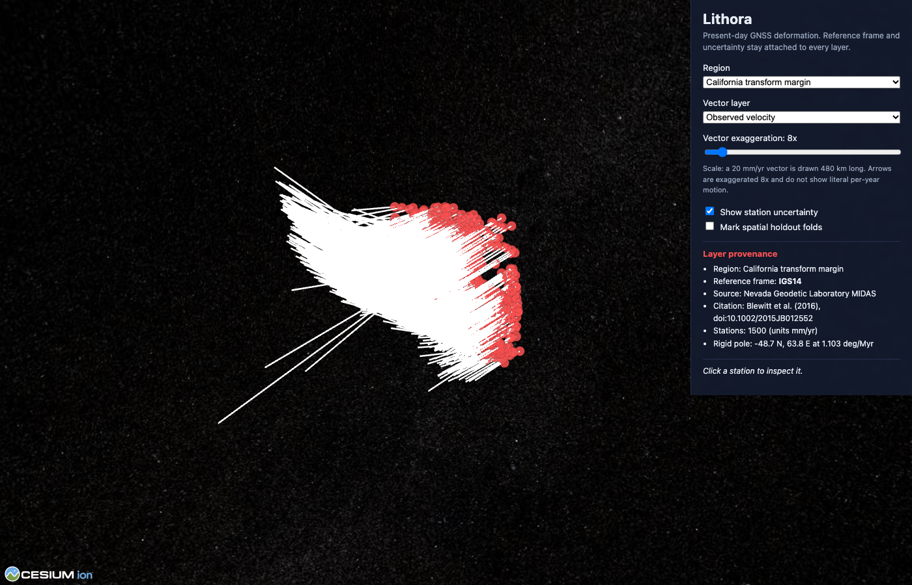

# Lithora

Lithora reconstructs tectonic plate motion through geological time and studies
present-day crustal deformation from geodetic observations. The core question
it is built to answer is where rigid-plate models explain measured motion,
where a learned residual field adds something real, and where the data are
simply too weak to say anything at all.

It is organised around one honest distinction: ancient reconstruction and
modern geodesy are connected by geological interpretation, not by pretending a
few years of GPS measures where a continent sat hundreds of millions of years
ago. The two clocks stay separate everywhere in the system.

## What is here today

The spherical-geometry and plate-kinematics core is implemented from first
principles in Rust and is fully tested:

- Unit-quaternion finite rotations with stable composition, including the
  small-angle, near-antipodal, identity, and noncommutative cases.
- Spherical linear interpolation of rotations over geological age, with the
  explicit distinction from interpolating Cartesian positions (a chord through
  the sphere is the wrong answer, and a test enforces that).
- Plate-circuit evaluation as a time-dependent graph: chaining to an anchor,
  re-anchoring consistently, and surfacing cycles, missing intervals, and
  out-of-range ages as explicit errors rather than plausible numbers.
- Angular and linear surface velocity (`v = omega x r`), with stage rotations
  checked against the analytic cross product.
- Spherical polygon containment, area, and orientation that handle the
  antimeridian, polar caps, and holes.
- A `.rot` rotation-file parser and a reconstruction CLI.

## Try it

No downloaded data is needed for the bounded demo. It runs on a small built-in
synthetic model that is clearly labelled as synthetic.

```
cargo run -p lithora-cli -- demo
```

Expected output traces a point on a plate backward through time and reports a
present-day stage speed:

```
Lithora demo on synthetic model 'synthetic-demo' (2 links)
Tracking a point on plate 801 at (12 N, 45 E):
     0.0 Ma -> ( 12.0000 N,   45.0000 E)
    25.0 Ma -> ( 14.5952 N,   46.4546 E)
    50.0 Ma -> ( 17.3099 N,   47.8581 E)
    75.0 Ma -> ( 20.1372 N,   49.2085 E)
   100.0 Ma -> ( 23.0700 N,   50.5044 E)
Present-day stage speed at the point: 12.98 mm/yr
```

Reconstruct a single point from your own rotation file:

```
cargo run -p lithora-cli -- reconstruct --rot model.rot --plate 801 --lat 12 --lon 45 --age 50
```

## Build and test

```
cargo build --workspace
cargo test --workspace
```

## Layout

- `crates/lithora-geo`: the original spherical-geometry and kinematics core.
- `crates/lithora-recon`: rotation-file parsing and reconstruction orchestration.
- `crates/lithora-cli`: the command-line tool and demo.
- `docs/`: architecture, specification, and build status.

## Measured results on real data

Lithora acquires real GNSS velocities from the Nevada Geodetic Laboratory MIDAS
product (20,168 IGS14 stations, 16,002 with at least five years of data) and
runs the same pipeline across regions:

- North America interior (1,374 stations): a single rigid Euler pole explains
  the field to a 0.44 mm/yr median residual against a 15.4 mm/yr observed
  field, and no residual model improves held-out prediction. The rigid null
  wins in a rigid interior, as it should.
- California transform margin (1,552 stations): on spatially buffered folds the
  residual models cut held-out vector RMSE from 14.8 (rigid) to 6.4 mm/yr
  (local regression), and the Gaussian process is measurably overconfident
  there (1-sigma coverage about 0.09), a real calibration-failure finding.

Reproduce:

```
make bootstrap && make acquire-gnss
python -m lithora.cli fit-plates --frame IGS14 --region na
python -m lithora.cli spatial-evaluate --frame IGS14 --region cal
```

## Atlas

An interactive CesiumJS globe renders the real velocity fields with model-layer
switching, exaggeration plus a scale legend, station uncertainty, spatial
holdout coloring, and a provenance panel that always shows the reference frame.



```
cd web && npm install && npm run dev
```

See `docs/research/` for the twelve research notes, `docs/DERIVATIONS.md` for
the mathematics, `docs/ARCHITECTURE.md` for the system structure, and
`docs/diagrams/` for the rendered diagrams.

## Honesty notes

Lithora does not predict earthquake dates or magnitudes. Where a reconstruction
model has no topology for a time, that time is unsupported and reported as such
rather than interpolated through. Synthetic data used for tests is always
labelled synthetic. See `docs/BUILD_STATUS.md` for exactly what is built versus
what is still pending or blocked on external data.

## License

MIT. See `LICENSE`.
