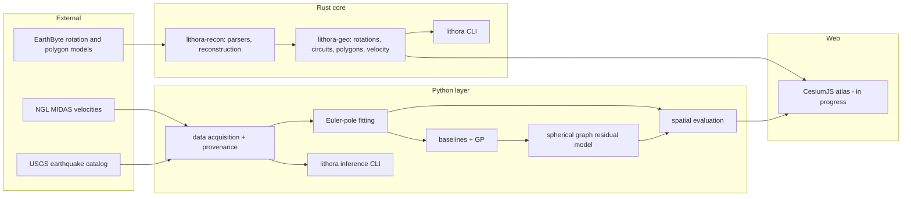

# Architecture

Lithora is three cooperating layers with a strict separation of concerns: an
original Rust kinematics core, a Python inference and research layer, and (in
progress) a TypeScript globe. Data flows one way through them, and every stage
keeps the provenance it needs to stay honest about time, reference frame, and
uncertainty.

## System context

## Layer responsibilities

### Rust core (`crates/`)

The authoritative geometry and kinematics live here because the reconstruction
math must be exact, fast, and free of hidden library magic. The core question
of where rigid models explain motion depends on this code being correct to the
declared tolerances (gate G01, G02, G03).

- `lithora-geo` is dependency-light (only `serde` and `thiserror`). It owns the
  units, coordinate conventions, quaternion finite rotations, piecewise
  interpolation, plate-circuit evaluation, velocity math, and spherical
  polygon operations. Nothing in it reaches out to the network or the file
  system.
- `lithora-recon` adds the `.rot` parser and assembles a `Model` that answers
  reconstruction queries. It depends only on `lithora-geo`.
- `lithora-cli` is the user-facing binary with a zero-data demo.

### Python layer (`python/`)

The statistical inference, learning, and research tooling live here where
NumPy, SciPy, and PyTorch are the right tools. This layer consumes the Rust
core's conventions but never reimplements the reconstruction engine.

- `data/` acquires NGL and USGS data with provenance and refuses to mix
  reference frames.
- `euler_fit.py` solves the rigid inverse problem; `baselines.py` and `gp.py`
  are the non-learned references; `graph_model.py` and `train.py` are the
  original learned residual model.
- `evaluate.py` builds spatially buffered folds and computes the metrics that
  make a model comparison trustworthy.
- `cli.py` wires it together so the Makefile targets drive the tested code.

### Web layer (`web/`, in progress)

An interactive globe that renders reconstructed geometry and present-day
velocity fields with their uncertainty and provenance, keeping the modern and
geological clocks separate.

## Ownership and data flow

A single reconstruction request flows: a rotation model is parsed into plate
circuit links, a point and age enter the circuit, each link is interpolated by
slerp, the chain composes to a total rotation relative to the anchor, and the
point is rotated. A velocity request additionally takes a short stage near the
requested time and divides by the interval. See
`docs/walkthroughs/reconstruct_point.md` for the line-by-line path.

A deformation request flows: GNSS velocities in one frame are fit to a rigid
pole, the residual field is modelled by a baseline or the graph model, and
spatial folds hold out blocks with a buffer to measure honest error and
calibration.

## Boundaries that are enforced, not just documented

- Reference frames never mix silently (`data/ngl.py::merge_same_frame`).
- Ages outside a model's range raise `AgeOutOfRange` rather than extrapolate.
- The learned model sees only rotation-invariant tangent features, so it
  cannot learn a longitude artifact (verified by the equivariance test).
- Raw downloads and private accounting never enter Git (`.gitignore`).
